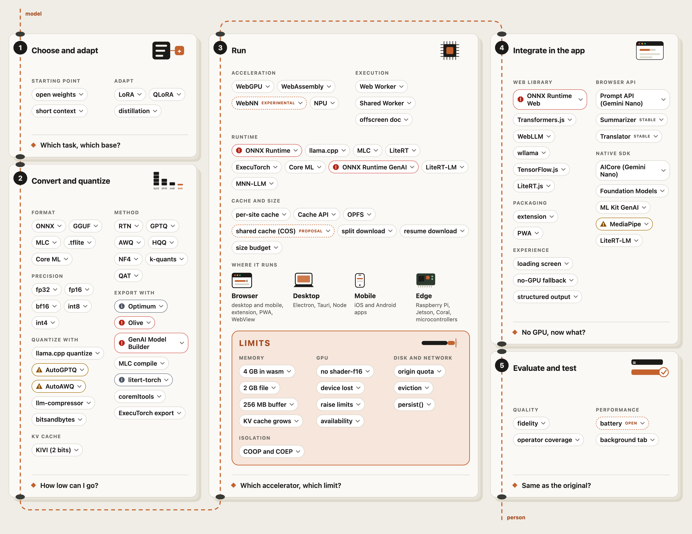

# State of the Art of WebAI

A map of everything between a model and a person when the model runs in a browser, on a phone or on an edge board: choosing and adapting the model, converting and quantizing it, running it, putting it inside an app, and testing it.

It is an awesome list and a landscape in one picture. Every chip is a technology, a technique or a limit, and every chip opens at least two sources it rests on, with the date they were read. A chip can carry a dated alert (a broken link, a deprecation) with its evidence.



**Live page:** `docs/index.html` (scaled to fit the window; `?fit=0` for the full-size layout; static; switch language with the buttons or `?lang=pt`, theme with the sun and moon buttons). [Português](README.pt.md).

## How it works

| File | What it is |
|---|---|
| [SPEC.md](SPEC.md) | The specification (version 0.4): data model, rules, i18n, curation, versioning. |
| `data/layers.yml` | The layers, groups and chips. Each chip has `sources` (at least two distinct links) and, when something was observed, an `alert`. |
| `i18n/en.yml`, `i18n/pt.yml` | One text per id. English is the reference language. |
| `schema/` | JSON Schemas for the two kinds of file. |
| `assets/` | CSS, the small script, and the icons (SVG). |
| `build.py` | Builds `docs/index.html` and refreshes the list below. |
| `export.py` | Exports a PNG per language with headless Chrome. |
| `scripts/check.py` | Validates the data and the translations against the spec. CI runs it. |
| `scripts/linkcheck.py` | Opens every link and reports dead or moved ones (network; not in CI). |

```sh
python3 scripts/check.py   # validate
python3 build.py           # docs/index.html and the list below
python3 export.py          # docs/figure-<lang>.png (needs Chrome or Chromium)
```

Python 3.10+ is enough (PyYAML is used if installed, otherwise a tiny built-in reader handles the files).

## Contributing

Add a chip, fix a source, or translate the whole map. See [CONTRIBUTING.md](CONTRIBUTING.md). The short version: no chip without a source, and every text lives in `i18n/`.

## Motion

The dashed model line marches along its path and a small dot travels it; the four "Where it runs" items rise in, lift on hover and focus, and each icon has a small motion of its own. It is decoration only: nothing depends on it. It is off when the system asks for reduced motion, with `?motion=0`, and in the PNG export. It is plain CSS and SVG, no library.

## Open items

Chips waiting for a good source (two are needed): base model, narrow task, per-device measurement, regression tests, streaming, and **MatMulNBits** (the ONNX Runtime int4 operator: today only the quantization page documents it; a second primary page is missing). Left out after checking: mistral.rs (its README shows no browser, phone or edge target) and a Transformers.js convert script (its docs now recommend Optimum). Pull requests with sources are welcome.

## License

Code: MIT ([LICENSE-CODE](LICENSE-CODE)). Data and texts: CC BY 4.0 ([LICENSE-DATA](LICENSE-DATA)).

## The list

<!-- awesome:start -->
_97 chips, 210 source links. Last reviewed: 2026-11-20. Generated from `data/layers.yml`: do not edit by hand._

### 1. Choose and adapt
_Which task, which base?_

**Starting point**

- **open weights** — Weights published openly, so they can be adapted, converted and shipped; SmolLM3-3B is Apache-2.0.
  - Docs: [SmolLM3-3B model card](https://huggingface.co/HuggingFaceTB/SmolLM3-3B)
  - Posts: [Hugging Face: SmolLM3 announcement](https://huggingface.co/blog/smollm3)
- **short context** — A short context keeps the KV cache small; the cache grows with every token kept.
  - Posts: [Hugging Face: KV cache quantization](https://huggingface.co/blog/kv-cache-quantization), [NVIDIA: LLM inference optimization](https://developer.nvidia.com/blog/mastering-llm-techniques-inference-optimization/)

**Adapt**

- **LoRA** — Freezes the base weights and trains small low-rank matrices, with no extra latency at inference.
  - Code: [LoRA reference code](https://github.com/microsoft/LoRA)
  - Papers: [LoRA paper](https://arxiv.org/abs/2106.09685)
- **QLoRA** — LoRA on a model frozen in 4 bits; fine-tunes a 65B model on a single 48 GB GPU.
  - Code: [QLoRA reference code](https://github.com/artidoro/qlora)
  - Papers: [QLoRA paper](https://arxiv.org/abs/2305.14314)
- **distillation** — Squeezes a larger model into a smaller one; DistilBERT is 40% smaller and 60% faster.
  - Papers: [Distilling the knowledge in a neural network](https://arxiv.org/abs/1503.02531), [DistilBERT](https://arxiv.org/abs/1910.01108)

### 2. Convert and quantize
_How low can I go?_

**Format**

- **ONNX** — Open graph format that ONNX Runtime executes in the browser and natively.
  - Docs: [ONNX Runtime Web: tutorials](https://onnxruntime.ai/docs/tutorials/web/), [ONNX project](https://onnx.ai/)
- **GGUF** — File format for GGML-based runtimes, designed for fast loading with mmap.
  - Docs: [Hugging Face Hub: GGUF](https://huggingface.co/docs/hub/gguf)
  - Code: [GGUF specification](https://github.com/ggml-org/ggml/blob/master/docs/gguf.md)
- **MLC** — Model packaging used by MLC and WebLLM to run on WebGPU.
  - Docs: [MLC LLM documentation](https://llm.mlc.ai/docs/)
  - Code: [WebLLM README](https://github.com/mlc-ai/web-llm)
- **.tflite** — Model format of LiteRT, formerly TensorFlow Lite, for on-device inference.
  - Docs: [LiteRT documentation](https://developers.google.com/edge/litert)
  - Code: [LiteRT repository](https://github.com/google-ai-edge/LiteRT)
- **Core ML** — Apple's model format for on-device inference; coremltools quantizes weights and activations.
  - Docs: [Apple: Core ML](https://developer.apple.com/documentation/coreml), [coremltools guide](https://apple.github.io/coremltools/docs-guides/)

**Precision**

- **fp32** — 32-bit floating point: 4 bytes per parameter.
  - Docs: [Wikipedia: single-precision](https://en.wikipedia.org/wiki/Single-precision_floating-point_format)
  - Posts: [Google Cloud: bfloat16](https://cloud.google.com/blog/products/ai-machine-learning/bfloat16-the-secret-to-high-performance-on-cloud-tpus)
- **fp16** — 16-bit IEEE float with a 5-bit exponent, range up to ±65,504.
  - Docs: [Wikipedia: half-precision](https://en.wikipedia.org/wiki/Half-precision_floating-point_format), [NVIDIA: mixed precision training](https://docs.nvidia.com/deeplearning/performance/mixed-precision-training/index.html)
- **bf16** — 16-bit brain float: fp32's range with 7 mantissa bits, so less precision.
  - Docs: [Wikipedia: bfloat16](https://en.wikipedia.org/wiki/Bfloat16_floating-point_format)
  - Posts: [Google Cloud: bfloat16](https://cloud.google.com/blog/products/ai-machine-learning/bfloat16-the-secret-to-high-performance-on-cloud-tpus)
- **int8** — 8-bit integers with a scale and zero point: value = scale × (quantized − zero point).
  - Docs: [ONNX Runtime: quantization](https://onnxruntime.ai/docs/performance/model-optimizations/quantization.html)
  - Papers: [Integer-arithmetic-only inference](https://arxiv.org/abs/1712.05877)
- **int4** — 4-bit weights: a 4× reduction in size compared with BF16.
  - Docs: [ONNX Runtime: quantization](https://onnxruntime.ai/docs/performance/model-optimizations/quantization.html), [Transformers: bitsandbytes (4-bit)](https://huggingface.co/docs/transformers/en/quantization/bitsandbytes)

**Quantize with**

- **llama.cpp quantize** — Takes a GGUF model in a high-precision type (F32, BF16) and converts it to a quantized type; an imatrix file can limit the accuracy loss.
  - Docs: [Hugging Face Hub: GGUF](https://huggingface.co/docs/hub/gguf)
  - Code: [llama.cpp: quantize tool](https://github.com/ggml-org/llama.cpp/blob/master/tools/quantize/README.md)
- **AutoGPTQ** — A GPTQ quantization package; its README says it is unmaintained and suggests GPTQModel, and the repository is archived.
  - 🟠 **Alert · Warning · Superseded** (Observed 2026-11-20): The AutoGPTQ README, read on 2026-11-20, begins: “AutoGPTQ is unmaintained - we suggest using GPTQModel for bug fixes and new models support”. The GitHub API reports the repository as archived (last push 2025-04-11).
  - Evidence: [github.com/AutoGPTQ/AutoGPTQ](https://github.com/AutoGPTQ/AutoGPTQ), [api.github.com/repos/AutoGPTQ/AutoGPTQ](https://api.github.com/repos/AutoGPTQ/AutoGPTQ), [github.com/ModelCloud/GPTQModel](https://github.com/ModelCloud/GPTQModel)
  - Code: [AutoGPTQ repository](https://github.com/AutoGPTQ/AutoGPTQ), [auto-gptq on PyPI](https://pypi.org/project/auto-gptq/)
- **AutoAWQ** — An AWQ quantization package; its README says it is officially deprecated and points to llm-compressor.
  - 🟠 **Alert · Warning · Deprecated** (Observed 2026-11-20): The AutoAWQ README, read on 2026-11-20, says: “AutoAWQ is officially deprecated and will no longer be maintained.” and that the vLLM project adopted it as llm-compressor. The GitHub API reports the repository as archived (last push 2025-05-11).
  - Evidence: [github.com/casper-hansen/AutoAWQ](https://github.com/casper-hansen/AutoAWQ), [api.github.com/repos/casper-hansen/AutoAWQ](https://api.github.com/repos/casper-hansen/AutoAWQ), [github.com/vllm-project/llm-compressor](https://github.com/vllm-project/llm-compressor)
  - Code: [AutoAWQ repository](https://github.com/casper-hansen/AutoAWQ), [autoawq on PyPI](https://pypi.org/project/autoawq/)
- **llm-compressor** — The vLLM project's library to compress LLMs for production inference; AutoAWQ's README says vLLM adopted AutoAWQ there.
  - Docs: [llm-compressor documentation](https://docs.vllm.ai/projects/llm-compressor/en/latest/)
  - Code: [llm-compressor repository](https://github.com/vllm-project/llm-compressor)
- **bitsandbytes** — k-bit quantization for PyTorch, with the 8-bit and 4-bit (NF4) types that QLoRA uses.
  - Docs: [bitsandbytes documentation](https://huggingface.co/docs/bitsandbytes/index)
  - Code: [bitsandbytes repository](https://github.com/bitsandbytes-foundation/bitsandbytes)

_Also exists (not drawn on the figure):_

- **torchao** — PyTorch-native quantization and training optimization; its README says new feature development is minimized.
  - Docs: [torchao documentation](https://docs.pytorch.org/ao/stable/)
  - Code: [torchao repository](https://github.com/pytorch/ao)

**Method**

- **RTN** — Round-to-nearest, the default 4-bit algorithm in ONNX Runtime, applied block by block.
  - Docs: [ONNX Runtime: quantization](https://onnxruntime.ai/docs/performance/model-optimizations/quantization.html)
  - Papers: [GPTQ paper (RTN baseline)](https://ar5iv.labs.arxiv.org/html/2210.17323)
- **GPTQ** — Calibrates 3 to 4 bit weights in one shot with second-order information; handles 175B models.
  - Code: [GPTQ reference code](https://github.com/IST-DASLab/gptq)
  - Papers: [GPTQ paper](https://arxiv.org/abs/2210.17323)
- **AWQ** — Protects the most important weight channels, chosen by activations.
  - Code: [AWQ reference code](https://github.com/mit-han-lab/llm-awq)
  - Papers: [AWQ paper](https://arxiv.org/abs/2306.00978)
- **HQQ** — A weight quantization algorithm ONNX Runtime offers next to RTN and GPTQ.
  - Docs: [ONNX Runtime: quantization](https://onnxruntime.ai/docs/performance/model-optimizations/quantization.html)
  - Code: [HQQ reference code](https://github.com/dropbox/hqq)
- **NF4** — 4-bit type for normally distributed weights, used by QLoRA.
  - Papers: [QLoRA paper](https://arxiv.org/abs/2305.14314)
  - Posts: [Hugging Face: 4-bit and bitsandbytes](https://huggingface.co/blog/4bit-transformers-bitsandbytes)
- **k-quants** — GGUF block formats with quantized scales; Q4_K uses 4.5 bits per weight.
  - Docs: [Hugging Face Hub: GGUF](https://huggingface.co/docs/hub/gguf)
  - Code: [llama.cpp: k-quants pull request](https://github.com/ggml-org/llama.cpp/pull/1684)
- **QAT** — Trains the model already knowing it will be quantized; Gemma 3 ships QAT versions.
  - Papers: [LLM-QAT paper](https://arxiv.org/abs/2305.17888)
  - Posts: [Google: Gemma 3 QAT](https://developers.googleblog.com/en/gemma-3-quantized-aware-trained-state-of-the-art-ai-to-consumer-gpus/)

**Export with**

- **Optimum** — Hugging Face's toolkit to export and optimize models; the Transformers.js docs recommend it to convert PyTorch models to ONNX.
  - ⚪ **Alert · Info · Moved** (Observed 2026-11-20): The Optimum README, read on 2026-11-20, says the ONNX integration was moved to optimum-onnx, which has its own installation instructions.
  - Evidence: [github.com/huggingface/optimum](https://github.com/huggingface/optimum), [github.com/huggingface/optimum-onnx](https://github.com/huggingface/optimum-onnx)
  - Docs: [Optimum documentation](https://huggingface.co/docs/optimum/index), [Transformers.js: custom usage](https://huggingface.co/docs/transformers.js/custom_usage)
  - Code: [Optimum repository](https://github.com/huggingface/optimum), [Optimum ONNX repository](https://github.com/huggingface/optimum-onnx)
- **Olive** — Microsoft's toolkit for the ONNX Runtime: model conversion, quantization and optimization for CPUs, GPUs and NPUs.
  - 🔴 **Alert · Critical · Link broken** (Observed 2026-11-20): On 2026-11-20 github.com/microsoft/Olive answers 404, on the web and in the GitHub API. The documentation site microsoft.github.io/Olive and PyPI olive-ai 0.13.0 (2026-06-09) still answer, and PyPI still links to that repository. No new address found.
  - Evidence: [github.com/microsoft/Olive](https://github.com/microsoft/Olive), [api.github.com/repos/microsoft/Olive](https://api.github.com/repos/microsoft/Olive), [pypi.org/project/olive-ai/](https://pypi.org/project/olive-ai/), [microsoft.github.io/Olive/](https://microsoft.github.io/Olive/)
  - Docs: [Olive documentation](https://microsoft.github.io/Olive/), [ONNX Runtime: Olive](https://onnxruntime.ai/docs/performance/olive.html)
  - Code: [olive-ai on PyPI](https://pypi.org/project/olive-ai/)
- **GenAI Model Builder** — The ONNX Runtime GenAI tool that builds an ONNX model for the generate() API from Hugging Face weights, in the precision you choose.
  - 🔴 **Alert · Critical · Link broken** (Observed 2026-11-20): On 2026-11-20 the page "Generate models using Model Builder" only points to the model builder guide at github.com/microsoft/onnxruntime-genai, which answers 404 (the whole repository does, on the web and in the GitHub API). The Phi-2 tutorial on onnxruntime.ai still describes the builder command. No new address found.
  - Evidence: [github.com/microsoft/onnxruntime-genai](https://github.com/microsoft/onnxruntime-genai), [api.github.com/repos/mic…ft/onnxruntime-genai](https://api.github.com/repos/microsoft/onnxruntime-genai), [github.com/microsoft/onn…/py/models/README.md](https://github.com/microsoft/onnxruntime-genai/blob/main/src/python/py/models/README.md), [onnxruntime.ai/docs/genai/](https://onnxruntime.ai/docs/genai/), [pypi.org/project/onnxruntime-genai/](https://pypi.org/project/onnxruntime-genai/)
  - Docs: [Generate models using Model Builder](https://onnxruntime.ai/docs/genai/howto/build-model.html), [Phi-2 with the generate() API](https://onnxruntime.ai/docs/genai/tutorials/phi2-python.html)
- **MLC compile** — Converts weights to the MLC format and compiles the model library so a model runs on the platform you target.
  - Docs: [MLC LLM: compile model libraries](https://llm.mlc.ai/docs/compilation/compile_models.html)
  - Code: [MLC LLM repository](https://github.com/mlc-ai/mlc-llm)
- **litert-torch** — Converts PyTorch models to LiteRT for on-device inference.
  - ⚪ **Alert · Info · Moved** (Observed 2026-11-20): On 2026-11-20 github.com/google-ai-edge/ai-edge-torch redirects (301) to github.com/google-ai-edge/litert-torch.
  - Evidence: [github.com/google-ai-edge/ai-edge-torch](https://github.com/google-ai-edge/ai-edge-torch), [github.com/google-ai-edge/litert-torch](https://github.com/google-ai-edge/litert-torch)
  - Docs: [LiteRT: convert PyTorch models](https://developers.google.com/edge/litert/conversion/pytorch/overview)
  - Code: [litert-torch repository](https://github.com/google-ai-edge/litert-torch)
- **coremltools** — Apple's tools to convert and edit models for Core ML, with weight and activation quantization.
  - Docs: [coremltools guide](https://apple.github.io/coremltools/docs-guides/)
  - Code: [coremltools repository](https://github.com/apple/coremltools)
- **ExecuTorch export** — Captures a PyTorch model with torch.export, optimizes it for the target hardware and produces an ExecuTorch program.
  - Docs: [ExecuTorch: export](https://docs.pytorch.org/executorch/main/using-executorch-export.html)
  - Code: [ExecuTorch repository](https://github.com/pytorch/executorch)

**KV cache**

- **KIVI (2 bits)** — Quantizes the KV cache to 2 bits: 2.6× less peak memory, including the weights.
  - Code: [KIVI reference code](https://github.com/jy-yuan/KIVI)
  - Papers: [KIVI paper](https://arxiv.org/abs/2402.02750)

### 3. Run
_Which accelerator, which limit?_

**Acceleration**

- **WebGPU** — GPU access for general computation, not only graphics; in the four major browsers, with platform gaps.
  - Docs: [MDN: WebGPU API](https://developer.mozilla.org/en-US/docs/Web/API/WebGPU_API)
  - Spec: [W3C: WebGPU](https://www.w3.org/TR/webgpu/)
  - Status: [web.dev: browser support](https://web.dev/blog/webgpu-supported-major-browsers)
- **WebAssembly** — SIMD and threads run on the CPU in Chrome, Firefox and Safari; threads need cross-origin isolation.
  - Docs: [WebAssembly feature support](https://webassembly.org/features/), [MDN: WebAssembly](https://developer.mozilla.org/en-US/docs/WebAssembly)
- **WebNN** · *experimental* — Low-level API for neural-network hardware (CPU, GPU, NPU); a draft that Chrome and Edge are testing.
  - Docs: [ONNX Runtime: WebNN execution provider](https://onnxruntime.ai/docs/tutorials/web/ep-webnn.html)
  - Spec: [W3C: WebNN](https://www.w3.org/TR/webnn/)
  - Status: [Chrome: origin trial](https://developer.chrome.com/blog/chrome-146-beta), [Mozilla: standards position](https://github.com/mozilla/standards-positions/issues/1215), [WebKit: standards position](https://github.com/WebKit/standards-positions/issues/486)
- **NPU** — WebNN lets the browser choose among CPU, GPU and NPU devices.
  - Docs: [ONNX Runtime: WebNN execution provider](https://onnxruntime.ai/docs/tutorials/web/ep-webnn.html)
  - Spec: [W3C: WebNN](https://www.w3.org/TR/webnn/)

**Execution**

- **Web Worker** — Runs inference off the main thread so the interface does not freeze.
  - Docs: [MDN: Worker](https://developer.mozilla.org/en-US/docs/Web/API/Worker)
  - Spec: [HTML Standard: web workers](https://html.spec.whatwg.org/multipage/workers.html)
- **Shared Worker** — One worker shared by several tabs of the same origin.
  - Docs: [MDN: SharedWorker](https://developer.mozilla.org/en-US/docs/Web/API/SharedWorker)
  - Spec: [HTML Standard: web workers](https://html.spec.whatwg.org/multipage/workers.html)
- **offscreen doc** — How a Chrome extension runs work that needs a DOM, since its service worker has none.
  - Docs: [Chrome: offscreen API](https://developer.chrome.com/docs/extensions/reference/api/offscreen)
  - Posts: [Chrome: offscreen documents](https://developer.chrome.com/blog/Offscreen-Documents-in-Manifest-v3)

**Runtime**

- **ONNX Runtime** — Runs ONNX models in the browser (WebAssembly, WebGPU, WebNN) and natively.
  - 🔴 **Alert · Critical · Link broken** (Observed 2026-11-20): On 2026-11-20 github.com/microsoft/onnxruntime answers 404, on the web and in the GitHub API; so do onnxruntime-genai and onnxruntime-extensions. PyPI onnxruntime 1.32.0 (2026-11-13), npm onnxruntime-web 1.31.1 and onnxruntime.ai still point to that address. No new address found: github.com/onnxruntime/onnxruntime also answers 404. The documentation site and the package registries still answer.
  - Evidence: [github.com/microsoft/onnxruntime](https://github.com/microsoft/onnxruntime), [api.github.com/repos/microsoft/onnxruntime](https://api.github.com/repos/microsoft/onnxruntime), [github.com/microsoft/onnxruntime-genai](https://github.com/microsoft/onnxruntime-genai), [github.com/microsoft/onnxruntime-extensions](https://github.com/microsoft/onnxruntime-extensions), [npmjs.com/package/onnxruntime-web](https://www.npmjs.com/package/onnxruntime-web), [pypi.org/project/onnxruntime/](https://pypi.org/project/onnxruntime/), [github.com/microsoft/vcpkg/issues/55189](https://github.com/microsoft/vcpkg/issues/55189)
  - Docs: [ONNX Runtime](https://onnxruntime.ai/), [ONNX Runtime documentation](https://onnxruntime.ai/docs/)
- **llama.cpp** — C/C++ inference for GGUF models, with Android and Apple Metal builds.
  - Docs: [Hugging Face Hub: llama.cpp](https://huggingface.co/docs/hub/gguf-llamacpp)
  - Code: [llama.cpp](https://github.com/ggml-org/llama.cpp)
- **MLC** — The runtime behind WebLLM, running compiled models on WebGPU.
  - Code: [WebLLM README](https://github.com/mlc-ai/web-llm), [MLC LLM repository](https://github.com/mlc-ai/mlc-llm)
- **LiteRT** — Google's on-device runtime, formerly TensorFlow Lite; used by 250K+ apps.
  - Docs: [LiteRT documentation](https://developers.google.com/edge/litert)
  - Code: [LiteRT repository](https://github.com/google-ai-edge/LiteRT)
- **ExecuTorch** — PyTorch runtime for the edge: Android, iOS, desktop and embedded, with XNNPACK, Core ML and Vulkan backends.
  - Docs: [ExecuTorch documentation](https://docs.pytorch.org/executorch/)
  - Code: [ExecuTorch](https://github.com/pytorch/executorch)
- **Core ML** — Apple's framework for running models on a person's device.
  - Docs: [Apple: Core ML](https://developer.apple.com/documentation/coreml)
  - Code: [coremltools repository](https://github.com/apple/coremltools)
- **ONNX Runtime GenAI** — The generative AI loop for ONNX models: tokenization, search and sampling, KV cache management and a generate() API, in preview.
  - 🔴 **Alert · Critical · Link broken** (Observed 2026-11-20): On 2026-11-20 github.com/microsoft/onnxruntime-genai answers 404, on the web and in the GitHub API, like the other ONNX Runtime repositories. The documentation at onnxruntime.ai still links to it and says the API is in preview; PyPI onnxruntime-genai 0.20.0 (2026-11-14) still answers. No new address found.
  - Evidence: [github.com/microsoft/onnxruntime-genai](https://github.com/microsoft/onnxruntime-genai), [api.github.com/repos/mic…ft/onnxruntime-genai](https://api.github.com/repos/microsoft/onnxruntime-genai), [github.com/microsoft/onn…/py/models/README.md](https://github.com/microsoft/onnxruntime-genai/blob/main/src/python/py/models/README.md), [onnxruntime.ai/docs/genai/](https://onnxruntime.ai/docs/genai/), [pypi.org/project/onnxruntime-genai/](https://pypi.org/project/onnxruntime-genai/)
  - Docs: [ONNX Runtime generate() API](https://onnxruntime.ai/docs/genai/), [Install the generate() API](https://onnxruntime.ai/docs/genai/howto/install.html)
  - Code: [onnxruntime-genai on PyPI](https://pypi.org/project/onnxruntime-genai/)
- **LiteRT-LM** — Google's orchestration layer to run LLMs with LiteRT: cross-platform, with a command-line tool and Python, Kotlin, Swift, Web and C++ APIs.
  - Docs: [LiteRT-LM overview](https://developers.google.com/edge/litert-lm/overview)
  - Code: [LiteRT-LM repository](https://github.com/google-ai-edge/LiteRT-LM), [litert-lm on PyPI](https://pypi.org/project/litert-lm/)
- **MNN-LLM** — The LLM module of Alibaba's MNN inference engine: it exports PyTorch models to MNN and runs text generation; MNN ships Android chat apps.
  - Docs: [MNN: LLM documentation](https://mnn-docs.readthedocs.io/en/latest/transformers/llm.html)
  - Code: [MNN repository](https://github.com/alibaba/MNN)

_Also exists (not drawn on the figure):_

- **ExecuTorch LLM** — ExecuTorch's building blocks for local LLMs: quantized text models, long context, tool calling, speculative decoding, a local server.
  - Docs: [ExecuTorch: working with LLMs](https://docs.pytorch.org/executorch/main/llm/working-with-llms.html)
  - Code: [ExecuTorch repository](https://github.com/pytorch/executorch)
- **Candle** — Hugging Face's minimalist Rust ML framework; its online demos run LLaMA2 and T5 text generation entirely in the browser.
  - Docs: [The Candle book](https://huggingface.github.io/candle/)
  - Code: [Candle repository](https://github.com/huggingface/candle)
- **Burn** — A Rust deep-learning framework whose backends include WebGPU and a no_std CPU backend.
  - Docs: [The Burn book](https://burn.dev/books/burn/)
  - Code: [Burn repository](https://github.com/tracel-ai/burn)

**Cache and size**

- **per-site cache** — The HTTP cache is keyed by site, so two sites cannot reuse one downloaded file.
  - Docs: [MDN: state partitioning](https://developer.mozilla.org/en-US/docs/Web/Privacy/Guides/State_Partitioning)
  - Posts: [Chrome: HTTP cache partitioning](https://developer.chrome.com/blog/http-cache-partitioning)
- **Cache API** — Chrome's recommended store for model files; WebLLM and Transformers.js use it by default.
  - Docs: [Chrome: cache AI models](https://developer.chrome.com/docs/ai/cache-models), [Transformers.js: env](https://huggingface.co/docs/transformers.js/api/env), [ONNX Runtime: large models](https://onnxruntime.ai/docs/tutorials/web/large-models.html)
  - Code: [WebLLM: cacheBackend](https://raw.githubusercontent.com/mlc-ai/web-llm/main/README.md)
- **OPFS** — Origin private file system: private storage with synchronous access inside workers.
  - Docs: [MDN: origin private file system](https://developer.mozilla.org/en-US/docs/Web/API/File_System_API/Origin_private_file_system), [web.dev: origin private file system](https://web.dev/articles/origin-private-file-system)
- **shared cache (COS)** · *proposal* — Proposal: ask for a file by its hash and share it across sites. No browser ships it natively yet.
  - Docs: [Chrome: introducing Cross-Origin Storage](https://developer.chrome.com/blog/introducing-cross-origin-storage)
  - Spec: [WICG explainer](https://github.com/WICG/cross-origin-storage)
  - Posts: [Hugging Face: Cross-Origin Storage](https://huggingface.co/blog/cross-origin-storage)
  - Status: [Mozilla: standards position](https://github.com/mozilla/standards-positions/issues/1427), [WebKit: standards position](https://github.com/WebKit/standards-positions/issues/703)
- **split download** — Download a large model in parallel chunks and stitch them together on the client.
  - Docs: [Chrome: cache AI models](https://developer.chrome.com/docs/ai/cache-models), [MDN: range requests](https://developer.mozilla.org/en-US/docs/Web/HTTP/Guides/Range_requests)
- **resume download** — Range requests let a download pause and resume.
  - Docs: [MDN: range requests](https://developer.mozilla.org/en-US/docs/Web/HTTP/Guides/Range_requests)
  - Spec: [RFC 9110: HTTP semantics](https://www.rfc-editor.org/rfc/rfc9110.html)
- **size budget** — Download size is parameters × bytes per parameter: 3.08B parameters is 6.2 GB in bf16 and 1.7 GB in int4.
  - Docs: [ONNX Runtime: quantization](https://onnxruntime.ai/docs/performance/model-optimizations/quantization.html), [SmolLM3-3B model card](https://huggingface.co/HuggingFaceTB/SmolLM3-3B)

**Where it runs**

- [Browser](https://web.dev/blog/webgpu-supported-major-browsers) — desktop and mobile, extension, PWA, WebView
- [Desktop](https://www.electronjs.org/) — Electron, Tauri, Node
- [Mobile](https://github.com/pytorch/executorch) — iOS and Android apps
- [Edge](https://www.raspberrypi.com/products/raspberry-pi-5/) — Raspberry Pi, Jetson, Coral, microcontrollers

#### Limits

**Memory**

- **4 GB in wasm** — 32-bit WebAssembly memory tops out at 4 GB.
  - Docs: [V8: 4 GB of Wasm memory](https://v8.dev/blog/4gb-wasm-memory), [WebAssembly 3.0](https://webassembly.org/news/2025-09-17-wasm-3.0/)
- **2 GB file** — Files above 2 GB hit ArrayBuffer and protobuf limits; ONNX uses external data files.
  - Docs: [ONNX Runtime: large models](https://onnxruntime.ai/docs/tutorials/web/large-models.html)
  - Code: [wllama README](https://github.com/ngxson/wllama)
- **256 MB buffer** — WebGPU's default maxBufferSize is 256 MB (storage binding 128 MB); more can be requested.
  - Docs: [MDN: GPUSupportedLimits](https://developer.mozilla.org/en-US/docs/Web/API/GPUSupportedLimits)
  - Spec: [W3C: WebGPU](https://www.w3.org/TR/webgpu/)
- **KV cache grows** — The KV cache grows with every token: about 72 KiB per token for SmolLM3-3B in fp16.
  - Posts: [Hugging Face: KV cache quantization](https://huggingface.co/blog/kv-cache-quantization), [NVIDIA: LLM inference optimization](https://developer.nvidia.com/blog/mastering-llm-techniques-inference-optimization/)

**GPU**

- **no shader-f16** — The shader-f16 feature is optional, so half-precision kernels may be unavailable.
  - Docs: [MDN: GPUSupportedFeatures](https://developer.mozilla.org/en-US/docs/Web/API/GPUSupportedFeatures)
  - Posts: [Chrome: new in WebGPU 120](https://developer.chrome.com/blog/new-in-webgpu-120)
- **device lost** — The GPU device can be lost; handle the lost promise and recover.
  - Docs: [MDN: GPUDevice.lost](https://developer.mozilla.org/en-US/docs/Web/API/GPUDevice/lost)
  - Code: [WebLLM issue 517](https://github.com/mlc-ai/web-llm/issues/517)
- **raise limits** — Ask for higher limits with requiredLimits when requesting the device.
  - Docs: [MDN: requestDevice](https://developer.mozilla.org/en-US/docs/Web/API/GPUAdapter/requestDevice)
  - Spec: [W3C: WebGPU](https://www.w3.org/TR/webgpu/)
- **availability** — WebGPU availability varies by browser and platform.
  - Status: [web.dev: browser support](https://web.dev/blog/webgpu-supported-major-browsers), [gpuweb: implementation status](https://github.com/gpuweb/gpuweb/wiki/Implementation-Status)

**Disk and network**

- **origin quota** — Browsers manage storage per origin; the quota depends on the engine and the disk.
  - Docs: [MDN: quotas and eviction](https://developer.mozilla.org/en-US/docs/Web/API/Storage_API/Storage_quotas_and_eviction_criteria), [web.dev: storage for the web](https://web.dev/articles/storage-for-the-web)
- **eviction** — Stored data can be evicted, least recently used first, unless the origin asked for persistence.
  - Docs: [MDN: StorageManager.persist](https://developer.mozilla.org/en-US/docs/Web/API/StorageManager/persist), [web.dev: persistent storage](https://web.dev/articles/persistent-storage)
- **persist()** — navigator.storage.persist() asks the browser not to evict your origin's data.
  - Docs: [MDN: StorageManager.persist](https://developer.mozilla.org/en-US/docs/Web/API/StorageManager/persist), [MDN: quotas and eviction](https://developer.mozilla.org/en-US/docs/Web/API/Storage_API/Storage_quotas_and_eviction_criteria)

**Isolation**

- **COOP and COEP** — Cross-origin isolation is required for WebAssembly threads.
  - Docs: [MDN: crossOriginIsolated](https://developer.mozilla.org/en-US/docs/Web/API/Window/crossOriginIsolated), [ONNX Runtime: env flags](https://onnxruntime.ai/docs/tutorials/web/env-flags-and-session-options.html)

### 4. Integrate in the app
_No GPU, now what?_

**Web library**

- **ONNX Runtime Web** — ONNX Runtime for the browser, with WebGPU, WebAssembly and WebNN backends.
  - 🔴 **Alert · Critical · Link broken** (Observed 2026-11-20): On 2026-11-20 the repository listed by npm for onnxruntime-web 1.31.1 (published 2026-10-26), github.com/Microsoft/onnxruntime, answers 404, on the web and in the GitHub API. No new address found. The documentation site and the npm registry still answer.
  - Evidence: [github.com/microsoft/onnxruntime](https://github.com/microsoft/onnxruntime), [api.github.com/repos/microsoft/onnxruntime](https://api.github.com/repos/microsoft/onnxruntime), [github.com/microsoft/onnxruntime-genai](https://github.com/microsoft/onnxruntime-genai), [github.com/microsoft/onnxruntime-extensions](https://github.com/microsoft/onnxruntime-extensions), [npmjs.com/package/onnxruntime-web](https://www.npmjs.com/package/onnxruntime-web), [pypi.org/project/onnxruntime/](https://pypi.org/project/onnxruntime/), [github.com/microsoft/vcpkg/issues/55189](https://github.com/microsoft/vcpkg/issues/55189)
  - Docs: [ONNX Runtime Web: tutorials](https://onnxruntime.ai/docs/tutorials/web/), [ONNX Runtime: get started with the web](https://onnxruntime.ai/docs/get-started/with-javascript/web.html)
- **Transformers.js** — Hugging Face's JavaScript library; caches models with the Cache API by default.
  - Docs: [Transformers.js documentation](https://huggingface.co/docs/transformers.js/index)
  - Code: [Transformers.js repository](https://github.com/huggingface/transformers.js)
- **WebLLM** — In-browser LLM engine on WebGPU, with Chrome extension support and several cache backends.
  - Docs: [WebLLM documentation](https://webllm.mlc.ai/docs/)
  - Code: [WebLLM README](https://github.com/mlc-ai/web-llm)
- **wllama** — WebAssembly bindings for llama.cpp; split models into chunks of up to 512 MB.
  - Docs: [wllama documentation](https://github.ngxson.com/wllama/docs/)
  - Code: [wllama README](https://github.com/ngxson/wllama)
- **TensorFlow.js** — Machine learning in JavaScript, in the browser and in Node.
  - Docs: [TensorFlow.js documentation](https://www.tensorflow.org/js)
  - Code: [TensorFlow.js](https://github.com/tensorflow/tfjs)
- **LiteRT.js** — LiteRT for the web, from Google AI Edge.
  - Docs: [LiteRT for the web](https://developers.google.com/edge/litert/web)
  - Code: [@litertjs/core on npm](https://www.npmjs.com/package/@litertjs/core)

**Packaging**

- **extension** — Browser extensions can run models; WebLLM supports Chrome extensions.
  - Code: [WebLLM README](https://github.com/mlc-ai/web-llm), [WebLLM: Chrome extension example](https://github.com/mlc-ai/web-llm/tree/main/examples/chrome-extension)
- **PWA** — Installable web apps that keep working offline.
  - Docs: [MDN: progressive web apps](https://developer.mozilla.org/en-US/docs/Web/Progressive_web_apps), [web.dev: learn PWA](https://web.dev/learn/pwa)

**Experience**

- **loading screen** — Tell people the model is downloading; Chrome documents how to inform users.
  - Docs: [Chrome: built-in AI](https://developer.chrome.com/docs/ai/built-in), [Chrome: inform users of the model download](https://developer.chrome.com/docs/ai/inform-users-of-model-download)
- **no-GPU fallback** — WebGPU is experimental in some browsers; a WebAssembly path can run where it fails.
  - Docs: [Transformers.js: WebGPU guide](https://huggingface.co/docs/transformers.js/guides/webgpu), [ONNX Runtime Web: tutorials](https://onnxruntime.ai/docs/tutorials/web/)
- **structured output** — Grammar-constrained decoding forces valid JSON or another format.
  - Code: [llama.cpp: grammars](https://github.com/ggml-org/llama.cpp)
  - Papers: [XGrammar paper](https://arxiv.org/abs/2411.15100)

**Browser API**

- **Prompt API (Gemini Nano)** — Prompt a model the browser downloads and manages for you; status varies by context, see the page.
  - Docs: [Chrome: Prompt API](https://developer.chrome.com/docs/ai/prompt-api), [Chrome: built-in model management](https://developer.chrome.com/docs/ai/understand-built-in-model-management), [Chrome: built-in AI APIs](https://developer.chrome.com/docs/ai/built-in-apis)
- **Summarizer** · *stable* — Built-in browser API that summarizes text; the browser manages the model.
  - Docs: [Chrome: built-in AI APIs](https://developer.chrome.com/docs/ai/built-in-apis), [Chrome: Summarizer API](https://developer.chrome.com/docs/ai/summarizer-api)
- **Translator** · *stable* — Built-in browser API that translates text; the browser manages the model.
  - Docs: [Chrome: built-in AI APIs](https://developer.chrome.com/docs/ai/built-in-apis), [Chrome: Translator API](https://developer.chrome.com/docs/ai/translator-api)

**Native SDK**

- **AICore (Gemini Nano)** — Android system service that runs Gemini Nano and keeps the model up to date.
  - Docs: [Android: Gemini Nano](https://developer.android.com/ai/gemini-nano), [ML Kit GenAI APIs](https://developers.google.com/ml-kit/genai)
- **Foundation Models** — Apple's access to on-device and Private Cloud Compute models, with guided generation and tool calling.
  - Docs: [Apple: Foundation Models](https://developer.apple.com/documentation/foundationmodels)
  - Papers: [Apple Intelligence foundation models report](https://arxiv.org/abs/2507.13575)
- **ML Kit GenAI** — ML Kit GenAI APIs on Android use AICore and process data locally.
  - Docs: [Android: Gemini Nano](https://developer.android.com/ai/gemini-nano), [ML Kit GenAI APIs](https://developers.google.com/ml-kit/genai)
- **MediaPipe** — MediaPipe's LLM Inference API: its Android and iOS versions are deprecated in favor of LiteRT-LM; Web is not.
  - 🟠 **Alert · Warning · Deprecated** (Observed 2026-11-20): The official page of the LLM Inference API, archived on 2026-05-17, says its Android and iOS implementations are deprecated, that Web is not, and asks mobile projects to migrate to LiteRT-LM. In the archive the notice is absent on 2026-03-30 and present on 2026-04-05. On 2026-11-20 the page address redirects (301) to the LiteRT-LM page.
  - Evidence: [web.archive.org/web/2026…/genai/llm_inference](https://web.archive.org/web/20260517083853/https://ai.google.dev/edge/mediapipe/solutions/genai/llm_inference), [ai.google.dev/edge/media…/genai/llm_inference](https://ai.google.dev/edge/mediapipe/solutions/genai/llm_inference), [developers.google.com/edge/litert-lm](https://developers.google.com/edge/litert-lm)
  - Docs: [MediaPipe: LLM Inference (redirects to LiteRT-LM)](https://ai.google.dev/edge/mediapipe/solutions/genai/llm_inference)
  - Code: [MediaPipe repository](https://github.com/google-ai-edge/mediapipe)
  - Status: [Archived page with the notice (2026-05-17)](https://web.archive.org/web/20260517083853/https://ai.google.dev/edge/mediapipe/solutions/genai/llm_inference)
- **LiteRT-LM** — LLMs on Linux, macOS, Windows and Raspberry Pi through a CLI; supports speculative decoding.
  - Docs: [LiteRT-LM overview](https://developers.google.com/edge/litert-lm/overview)
  - Code: [LiteRT-LM on GitHub](https://github.com/google-ai-edge/LiteRT-LM)

### 5. Evaluate and test
_Same as the original?_

**Quality**

- **fidelity** — Quantization can degrade performance, so measure the quantized model against the original.
  - Docs: [ONNX Runtime: quantization](https://onnxruntime.ai/docs/performance/model-optimizations/quantization.html)
  - Posts: [Google: Gemma 3 QAT](https://developers.googleblog.com/en/gemma-3-quantized-aware-trained-state-of-the-art-ai-to-consumer-gpus/)
- **operator coverage** — WebGPU, WebGL and WebNN support only a subset of ONNX operators; WebAssembly supports all.
  - Docs: [ONNX Runtime Web: tutorials](https://onnxruntime.ai/docs/tutorials/web/)
  - Status: [WebNN: operation implementation status](https://webmachinelearning.github.io/webnn-status/)

**Performance**

- **battery** · *open* — Papers measure phone energy; no comparable, agreed measurement exists yet.
  - Papers: [On-device vs server energy](https://arxiv.org/abs/2609.11940), [Phone battery and launch time](https://arxiv.org/abs/2410.03613)
- **background tab** — Background tabs are throttled; timers slow down in Chrome 88 and later.
  - Docs: [MDN: setTimeout (inactive tabs)](https://developer.mozilla.org/en-US/docs/Web/API/Window/setTimeout)
  - Posts: [Chrome: timer throttling](https://developer.chrome.com/blog/timer-throttling-in-chrome-88)
<!-- awesome:end -->
