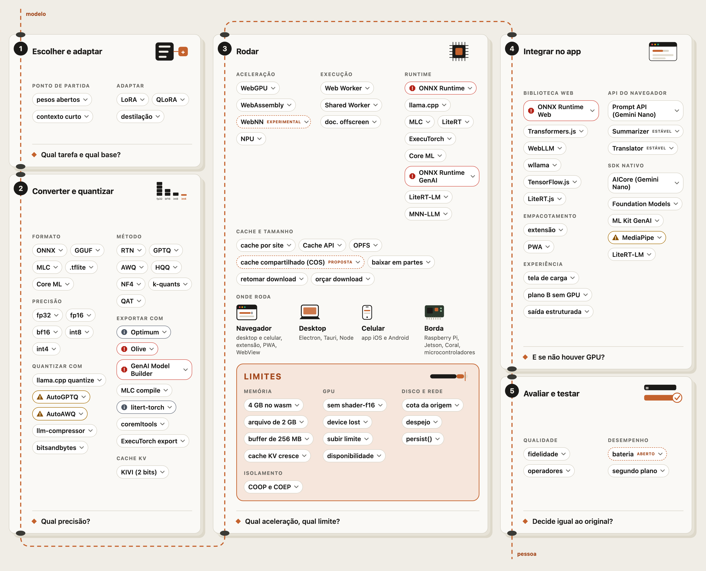

# State of the Art of WebAI

Um mapa de tudo o que existe entre um modelo e uma pessoa quando o modelo roda no navegador, no celular ou numa placa de borda: escolher e adaptar o modelo, converter e quantizar, rodar, integrar no app e testar.

É uma lista "awesome" e uma paisagem (landscape) numa figura só. Cada chip é uma tecnologia, técnica ou limite e abre ao menos duas fontes em que se apoia, com a data em que foram lidas. Um chip pode ter um alerta datado (link quebrado, descontinuação) com a sua evidência.



**Página:** `docs/index.html` (estática; troque o idioma pelos botões ou `?lang=pt`, e o tema pelos botões de sol e lua). [English](README.md).

## Como funciona

| Arquivo | O que é |
|---|---|
| [SPEC.md](SPEC.md) | A especificação (versão 0.4), em inglês: modelo de dados, regras, i18n, curadoria, versionamento. |
| `data/layers.yml` | As camadas, grupos e chips. Cada chip tem `sources` (no mínimo dois links distintos) e, quando algo foi observado, um `alert`. |
| `i18n/en.yml`, `i18n/pt.yml` | Um texto por id. O inglês é o idioma de referência. |
| `schema/` | JSON Schemas dos dois tipos de arquivo. |
| `build.py` | Gera `docs/index.html` e atualiza a lista abaixo. |
| `export.py` | Exporta um PNG por idioma com Chrome headless. |
| `scripts/check.py` | Valida os dados e as traduções contra a especificação. O CI roda. |
| `scripts/linkcheck.py` | Abre todos os links e aponta os mortos ou movidos (precisa de rede; fora do CI). |

```sh
python3 scripts/check.py   # validar
python3 build.py           # docs/index.html e a lista abaixo
python3 export.py          # docs/figure-<idioma>.png (precisa de Chrome ou Chromium)
```

## Contribuir

Adicione um chip, corrija uma fonte ou traduza o mapa inteiro. Veja o [CONTRIBUTING.md](CONTRIBUTING.md) (em inglês). Em resumo: nenhum chip com menos de duas fontes, e todo texto fica em `i18n/`. Para um idioma novo, copie `i18n/en.yml` para `i18n/<idioma>.yml` e traduza os valores; `python3 scripts/check.py` lista o que falta.

## Movimento

A linha tracejada do modelo anda pelo caminho e um pontinho a percorre; os quatro itens de "Onde roda" entram em sequência, sobem no hover e no foco, e cada ícone tem um movimento discreto. É só decoração: nenhuma informação depende dele. Fica desligado quando o sistema pede menos movimento, com `?motion=0` e no PNG exportado. É só CSS e SVG, sem biblioteca.

## Itens em aberto

Chips que aguardam boas fontes (são necessárias duas): modelo base, tarefa estreita, medida por aparelho, testes de regressão, streaming e **MatMulNBits** (o operador int4 do ONNX Runtime: hoje só a página de quantização o documenta; falta uma segunda página primária). Ficaram de fora depois de conferir: mistral.rs (o README não mostra alvo de navegador, celular ou borda) e um script de conversão do Transformers.js (a documentação agora recomenda o Optimum). Pull requests com fontes são bem-vindos.

## Licença

Código: MIT ([LICENSE-CODE](LICENSE-CODE)). Dados e textos: CC BY 4.0 ([LICENSE-DATA](LICENSE-DATA)).

## A lista

<!-- awesome:start -->
_97 chips, 210 links de fonte. Última revisão: 2026-11-20. Gerado a partir de `data/layers.yml`: não edite à mão._

### 1. Escolher e adaptar
_Qual tarefa e qual base?_

**Ponto de partida**

- **pesos abertos** — Pesos publicados abertamente, que podem ser adaptados, convertidos e distribuídos; o SmolLM3-3B é Apache-2.0.
  - Documentação: [SmolLM3-3B model card](https://huggingface.co/HuggingFaceTB/SmolLM3-3B)
  - Posts: [Hugging Face: SmolLM3 announcement](https://huggingface.co/blog/smollm3)
- **contexto curto** — Contexto curto mantém o cache KV pequeno; o cache cresce a cada token guardado.
  - Posts: [Hugging Face: KV cache quantization](https://huggingface.co/blog/kv-cache-quantization), [NVIDIA: LLM inference optimization](https://developer.nvidia.com/blog/mastering-llm-techniques-inference-optimization/)

**Adaptar**

- **LoRA** — Congela os pesos base e treina pequenas matrizes de baixo posto, sem latência extra na inferência.
  - Código: [LoRA reference code](https://github.com/microsoft/LoRA)
  - Artigos: [LoRA paper](https://arxiv.org/abs/2106.09685)
- **QLoRA** — LoRA sobre um modelo congelado em 4 bits; ajusta um modelo de 65B numa única GPU de 48 GB.
  - Código: [QLoRA reference code](https://github.com/artidoro/qlora)
  - Artigos: [QLoRA paper](https://arxiv.org/abs/2305.14314)
- **destilação** — Espreme um modelo maior num menor; o DistilBERT é 40% menor e 60% mais rápido.
  - Artigos: [Distilling the knowledge in a neural network](https://arxiv.org/abs/1503.02531), [DistilBERT](https://arxiv.org/abs/1910.01108)

### 2. Converter e quantizar
_Qual precisão?_

**Formato**

- **ONNX** — Formato aberto de grafo que o ONNX Runtime executa no navegador e em plataformas nativas.
  - Documentação: [ONNX Runtime Web: tutorials](https://onnxruntime.ai/docs/tutorials/web/), [ONNX project](https://onnx.ai/)
- **GGUF** — Formato de arquivo para runtimes baseados em GGML, feito para carregar rápido com mmap.
  - Documentação: [Hugging Face Hub: GGUF](https://huggingface.co/docs/hub/gguf)
  - Código: [GGUF specification](https://github.com/ggml-org/ggml/blob/master/docs/gguf.md)
- **MLC** — Empacotamento de modelo usado pelo MLC e pelo WebLLM para rodar em WebGPU.
  - Documentação: [MLC LLM documentation](https://llm.mlc.ai/docs/)
  - Código: [WebLLM README](https://github.com/mlc-ai/web-llm)
- **.tflite** — Formato de modelo do LiteRT, antigo TensorFlow Lite, para inferência no aparelho.
  - Documentação: [LiteRT documentation](https://developers.google.com/edge/litert)
  - Código: [LiteRT repository](https://github.com/google-ai-edge/LiteRT)
- **Core ML** — Formato de modelo da Apple para inferência no aparelho; o coremltools quantiza pesos e ativações.
  - Documentação: [Apple: Core ML](https://developer.apple.com/documentation/coreml), [coremltools guide](https://apple.github.io/coremltools/docs-guides/)

**Precisão**

- **fp32** — Ponto flutuante de 32 bits: 4 bytes por parâmetro.
  - Documentação: [Wikipedia: single-precision](https://en.wikipedia.org/wiki/Single-precision_floating-point_format)
  - Posts: [Google Cloud: bfloat16](https://cloud.google.com/blog/products/ai-machine-learning/bfloat16-the-secret-to-high-performance-on-cloud-tpus)
- **fp16** — Float IEEE de 16 bits com expoente de 5 bits, faixa até ±65.504.
  - Documentação: [Wikipedia: half-precision](https://en.wikipedia.org/wiki/Half-precision_floating-point_format), [NVIDIA: mixed precision training](https://docs.nvidia.com/deeplearning/performance/mixed-precision-training/index.html)
- **bf16** — Brain float de 16 bits: a faixa do fp32 com 7 bits de mantissa, logo menos precisão.
  - Documentação: [Wikipedia: bfloat16](https://en.wikipedia.org/wiki/Bfloat16_floating-point_format)
  - Posts: [Google Cloud: bfloat16](https://cloud.google.com/blog/products/ai-machine-learning/bfloat16-the-secret-to-high-performance-on-cloud-tpus)
- **int8** — Inteiros de 8 bits com escala e ponto zero: valor = escala × (quantizado − ponto zero).
  - Documentação: [ONNX Runtime: quantization](https://onnxruntime.ai/docs/performance/model-optimizations/quantization.html)
  - Artigos: [Integer-arithmetic-only inference](https://arxiv.org/abs/1712.05877)
- **int4** — Pesos de 4 bits: redução de 4× no tamanho em relação ao BF16.
  - Documentação: [ONNX Runtime: quantization](https://onnxruntime.ai/docs/performance/model-optimizations/quantization.html), [Transformers: bitsandbytes (4-bit)](https://huggingface.co/docs/transformers/en/quantization/bitsandbytes)

**Quantizar com**

- **llama.cpp quantize** — Pega um modelo GGUF em alta precisão (F32, BF16) e o converte para um tipo quantizado; um arquivo imatrix pode limitar a perda de precisão.
  - Documentação: [Hugging Face Hub: GGUF](https://huggingface.co/docs/hub/gguf)
  - Código: [llama.cpp: quantize tool](https://github.com/ggml-org/llama.cpp/blob/master/tools/quantize/README.md)
- **AutoGPTQ** — Pacote de quantização GPTQ; o README diz que está sem manutenção e sugere o GPTQModel, e o repositório está arquivado.
  - 🟠 **Alerta · Atenção · Substituído** (Observado em 2026-11-20): O README do AutoGPTQ, lido em 2026-11-20, começa com: “AutoGPTQ is unmaintained - we suggest using GPTQModel for bug fixes and new models support”. A API do GitHub informa o repositório como arquivado (último push em 2025-04-11).
  - Evidências: [github.com/AutoGPTQ/AutoGPTQ](https://github.com/AutoGPTQ/AutoGPTQ), [api.github.com/repos/AutoGPTQ/AutoGPTQ](https://api.github.com/repos/AutoGPTQ/AutoGPTQ), [github.com/ModelCloud/GPTQModel](https://github.com/ModelCloud/GPTQModel)
  - Código: [AutoGPTQ repository](https://github.com/AutoGPTQ/AutoGPTQ), [auto-gptq on PyPI](https://pypi.org/project/auto-gptq/)
- **AutoAWQ** — Pacote de quantização AWQ; o README diz que está oficialmente descontinuado e aponta para o llm-compressor.
  - 🟠 **Alerta · Atenção · Descontinuado** (Observado em 2026-11-20): O README do AutoAWQ, lido em 2026-11-20, diz: “AutoAWQ is officially deprecated and will no longer be maintained.” e que o projeto vLLM o adotou como llm-compressor. A API do GitHub informa o repositório como arquivado (último push em 2025-05-11).
  - Evidências: [github.com/casper-hansen/AutoAWQ](https://github.com/casper-hansen/AutoAWQ), [api.github.com/repos/casper-hansen/AutoAWQ](https://api.github.com/repos/casper-hansen/AutoAWQ), [github.com/vllm-project/llm-compressor](https://github.com/vllm-project/llm-compressor)
  - Código: [AutoAWQ repository](https://github.com/casper-hansen/AutoAWQ), [autoawq on PyPI](https://pypi.org/project/autoawq/)
- **llm-compressor** — Biblioteca do projeto vLLM para comprimir LLMs para inferência em produção; o README do AutoAWQ diz que o vLLM o adotou ali.
  - Documentação: [llm-compressor documentation](https://docs.vllm.ai/projects/llm-compressor/en/latest/)
  - Código: [llm-compressor repository](https://github.com/vllm-project/llm-compressor)
- **bitsandbytes** — Quantização em k bits para o PyTorch, com os tipos de 8 e 4 bits (NF4) que o QLoRA usa.
  - Documentação: [bitsandbytes documentation](https://huggingface.co/docs/bitsandbytes/index)
  - Código: [bitsandbytes repository](https://github.com/bitsandbytes-foundation/bitsandbytes)

_Também existe (fora da figura):_

- **torchao** — Quantização e otimização de treino nativas do PyTorch; o README diz que o desenvolvimento de novas funções está sendo minimizado.
  - Documentação: [torchao documentation](https://docs.pytorch.org/ao/stable/)
  - Código: [torchao repository](https://github.com/pytorch/ao)

**Método**

- **RTN** — Arredondamento ao mais próximo, o algoritmo de 4 bits padrão do ONNX Runtime, aplicado por bloco.
  - Documentação: [ONNX Runtime: quantization](https://onnxruntime.ai/docs/performance/model-optimizations/quantization.html)
  - Artigos: [GPTQ paper (RTN baseline)](https://ar5iv.labs.arxiv.org/html/2210.17323)
- **GPTQ** — Calibra pesos de 3 a 4 bits de uma vez com informação de segunda ordem; aguenta modelos de 175B.
  - Código: [GPTQ reference code](https://github.com/IST-DASLab/gptq)
  - Artigos: [GPTQ paper](https://arxiv.org/abs/2210.17323)
- **AWQ** — Protege os canais de pesos mais importantes, escolhidos pela ativação.
  - Código: [AWQ reference code](https://github.com/mit-han-lab/llm-awq)
  - Artigos: [AWQ paper](https://arxiv.org/abs/2306.00978)
- **HQQ** — Algoritmo de quantização de pesos que o ONNX Runtime oferece ao lado de RTN e GPTQ.
  - Documentação: [ONNX Runtime: quantization](https://onnxruntime.ai/docs/performance/model-optimizations/quantization.html)
  - Código: [HQQ reference code](https://github.com/dropbox/hqq)
- **NF4** — Tipo de 4 bits para pesos de distribuição normal, usado pelo QLoRA.
  - Artigos: [QLoRA paper](https://arxiv.org/abs/2305.14314)
  - Posts: [Hugging Face: 4-bit and bitsandbytes](https://huggingface.co/blog/4bit-transformers-bitsandbytes)
- **k-quants** — Formatos de bloco do GGUF com escalas quantizadas; o Q4_K usa 4,5 bits por peso.
  - Documentação: [Hugging Face Hub: GGUF](https://huggingface.co/docs/hub/gguf)
  - Código: [llama.cpp: k-quants pull request](https://github.com/ggml-org/llama.cpp/pull/1684)
- **QAT** — Treina o modelo já sabendo que será quantizado; o Gemma 3 tem versões com QAT.
  - Artigos: [LLM-QAT paper](https://arxiv.org/abs/2305.17888)
  - Posts: [Google: Gemma 3 QAT](https://developers.googleblog.com/en/gemma-3-quantized-aware-trained-state-of-the-art-ai-to-consumer-gpus/)

**Exportar com**

- **Optimum** — Kit da Hugging Face para exportar e otimizar modelos; a documentação do Transformers.js o recomenda para converter do PyTorch para ONNX.
  - ⚪ **Alerta · Informação · Mudou de endereço** (Observado em 2026-11-20): O README do Optimum, lido em 2026-11-20, diz que a integração com ONNX foi movida para o optimum-onnx, que tem instruções de instalação próprias.
  - Evidências: [github.com/huggingface/optimum](https://github.com/huggingface/optimum), [github.com/huggingface/optimum-onnx](https://github.com/huggingface/optimum-onnx)
  - Documentação: [Optimum documentation](https://huggingface.co/docs/optimum/index), [Transformers.js: custom usage](https://huggingface.co/docs/transformers.js/custom_usage)
  - Código: [Optimum repository](https://github.com/huggingface/optimum), [Optimum ONNX repository](https://github.com/huggingface/optimum-onnx)
- **Olive** — Kit da Microsoft para o ONNX Runtime: conversão, quantização e otimização de modelos para CPUs, GPUs e NPUs.
  - 🔴 **Alerta · Crítico · Link quebrado** (Observado em 2026-11-20): Em 2026-11-20 github.com/microsoft/Olive responde 404, na web e na API do GitHub. O site da documentação microsoft.github.io/Olive e o PyPI olive-ai 0.13.0 (2026-06-09) ainda respondem, e o PyPI ainda aponta para esse repositório. Não achei endereço novo.
  - Evidências: [github.com/microsoft/Olive](https://github.com/microsoft/Olive), [api.github.com/repos/microsoft/Olive](https://api.github.com/repos/microsoft/Olive), [pypi.org/project/olive-ai/](https://pypi.org/project/olive-ai/), [microsoft.github.io/Olive/](https://microsoft.github.io/Olive/)
  - Documentação: [Olive documentation](https://microsoft.github.io/Olive/), [ONNX Runtime: Olive](https://onnxruntime.ai/docs/performance/olive.html)
  - Código: [olive-ai on PyPI](https://pypi.org/project/olive-ai/)
- **GenAI Model Builder** — A ferramenta do ONNX Runtime GenAI que monta um modelo ONNX para a API generate() a partir de pesos da Hugging Face, na precisão escolhida.
  - 🔴 **Alerta · Crítico · Link quebrado** (Observado em 2026-11-20): Em 2026-11-20 a página "Generate models using Model Builder" só aponta para o guia do model builder em github.com/microsoft/onnxruntime-genai, que responde 404 (o repositório inteiro responde, na web e na API do GitHub). O tutorial do Phi-2 em onnxruntime.ai ainda descreve o comando do builder. Não achei endereço novo.
  - Evidências: [github.com/microsoft/onnxruntime-genai](https://github.com/microsoft/onnxruntime-genai), [api.github.com/repos/mic…ft/onnxruntime-genai](https://api.github.com/repos/microsoft/onnxruntime-genai), [github.com/microsoft/onn…/py/models/README.md](https://github.com/microsoft/onnxruntime-genai/blob/main/src/python/py/models/README.md), [onnxruntime.ai/docs/genai/](https://onnxruntime.ai/docs/genai/), [pypi.org/project/onnxruntime-genai/](https://pypi.org/project/onnxruntime-genai/)
  - Documentação: [Generate models using Model Builder](https://onnxruntime.ai/docs/genai/howto/build-model.html), [Phi-2 with the generate() API](https://onnxruntime.ai/docs/genai/tutorials/phi2-python.html)
- **MLC compile** — Converte os pesos para o formato MLC e compila a biblioteca do modelo para a plataforma de destino.
  - Documentação: [MLC LLM: compile model libraries](https://llm.mlc.ai/docs/compilation/compile_models.html)
  - Código: [MLC LLM repository](https://github.com/mlc-ai/mlc-llm)
- **litert-torch** — Converte modelos do PyTorch para o LiteRT, para inferência no aparelho.
  - ⚪ **Alerta · Informação · Mudou de endereço** (Observado em 2026-11-20): Em 2026-11-20 github.com/google-ai-edge/ai-edge-torch redireciona (301) para github.com/google-ai-edge/litert-torch.
  - Evidências: [github.com/google-ai-edge/ai-edge-torch](https://github.com/google-ai-edge/ai-edge-torch), [github.com/google-ai-edge/litert-torch](https://github.com/google-ai-edge/litert-torch)
  - Documentação: [LiteRT: convert PyTorch models](https://developers.google.com/edge/litert/conversion/pytorch/overview)
  - Código: [litert-torch repository](https://github.com/google-ai-edge/litert-torch)
- **coremltools** — Ferramentas da Apple para converter e editar modelos para o Core ML, com quantização de pesos e ativações.
  - Documentação: [coremltools guide](https://apple.github.io/coremltools/docs-guides/)
  - Código: [coremltools repository](https://github.com/apple/coremltools)
- **ExecuTorch export** — Captura um modelo do PyTorch com torch.export, otimiza para o hardware de destino e gera um programa ExecuTorch.
  - Documentação: [ExecuTorch: export](https://docs.pytorch.org/executorch/main/using-executorch-export.html)
  - Código: [ExecuTorch repository](https://github.com/pytorch/executorch)

**Cache KV**

- **KIVI (2 bits)** — Quantiza o cache KV em 2 bits: 2,6× menos memória de pico, contando os pesos.
  - Código: [KIVI reference code](https://github.com/jy-yuan/KIVI)
  - Artigos: [KIVI paper](https://arxiv.org/abs/2402.02750)

### 3. Rodar
_Qual aceleração, qual limite?_

**Aceleração**

- **WebGPU** — Acesso à GPU para computação geral, não só gráficos; nos quatro navegadores principais, com lacunas por plataforma.
  - Documentação: [MDN: WebGPU API](https://developer.mozilla.org/en-US/docs/Web/API/WebGPU_API)
  - Especificação: [W3C: WebGPU](https://www.w3.org/TR/webgpu/)
  - Estado: [web.dev: browser support](https://web.dev/blog/webgpu-supported-major-browsers)
- **WebAssembly** — SIMD e threads rodam na CPU no Chrome, Firefox e Safari; threads pedem isolamento de origem cruzada.
  - Documentação: [WebAssembly feature support](https://webassembly.org/features/), [MDN: WebAssembly](https://developer.mozilla.org/en-US/docs/WebAssembly)
- **WebNN** · *experimental* — API de baixo nível para hardware de redes neurais (CPU, GPU, NPU); rascunho que Chrome e Edge testam.
  - Documentação: [ONNX Runtime: WebNN execution provider](https://onnxruntime.ai/docs/tutorials/web/ep-webnn.html)
  - Especificação: [W3C: WebNN](https://www.w3.org/TR/webnn/)
  - Estado: [Chrome: origin trial](https://developer.chrome.com/blog/chrome-146-beta), [Mozilla: standards position](https://github.com/mozilla/standards-positions/issues/1215), [WebKit: standards position](https://github.com/WebKit/standards-positions/issues/486)
- **NPU** — O WebNN deixa o navegador escolher entre dispositivos de CPU, GPU e NPU.
  - Documentação: [ONNX Runtime: WebNN execution provider](https://onnxruntime.ai/docs/tutorials/web/ep-webnn.html)
  - Especificação: [W3C: WebNN](https://www.w3.org/TR/webnn/)

**Execução**

- **Web Worker** — Roda a inferência fora da thread principal, para a interface não travar.
  - Documentação: [MDN: Worker](https://developer.mozilla.org/en-US/docs/Web/API/Worker)
  - Especificação: [HTML Standard: web workers](https://html.spec.whatwg.org/multipage/workers.html)
- **Shared Worker** — Um worker compartilhado por várias abas da mesma origem.
  - Documentação: [MDN: SharedWorker](https://developer.mozilla.org/en-US/docs/Web/API/SharedWorker)
  - Especificação: [HTML Standard: web workers](https://html.spec.whatwg.org/multipage/workers.html)
- **doc. offscreen** — Como uma extensão do Chrome roda trabalho que precisa de DOM, já que o service worker não tem.
  - Documentação: [Chrome: offscreen API](https://developer.chrome.com/docs/extensions/reference/api/offscreen)
  - Posts: [Chrome: offscreen documents](https://developer.chrome.com/blog/Offscreen-Documents-in-Manifest-v3)

**Runtime**

- **ONNX Runtime** — Roda modelos ONNX no navegador (WebAssembly, WebGPU, WebNN) e em plataformas nativas.
  - 🔴 **Alerta · Crítico · Link quebrado** (Observado em 2026-11-20): Em 2026-11-20 github.com/microsoft/onnxruntime responde 404, na web e na API do GitHub; o mesmo vale para onnxruntime-genai e onnxruntime-extensions. O PyPI onnxruntime 1.32.0 (2026-11-13), o npm onnxruntime-web 1.31.1 e o onnxruntime.ai ainda apontam para esse endereço. Não achei endereço novo: github.com/onnxruntime/onnxruntime também responde 404. O site da documentação e os registros de pacotes ainda respondem.
  - Evidências: [github.com/microsoft/onnxruntime](https://github.com/microsoft/onnxruntime), [api.github.com/repos/microsoft/onnxruntime](https://api.github.com/repos/microsoft/onnxruntime), [github.com/microsoft/onnxruntime-genai](https://github.com/microsoft/onnxruntime-genai), [github.com/microsoft/onnxruntime-extensions](https://github.com/microsoft/onnxruntime-extensions), [npmjs.com/package/onnxruntime-web](https://www.npmjs.com/package/onnxruntime-web), [pypi.org/project/onnxruntime/](https://pypi.org/project/onnxruntime/), [github.com/microsoft/vcpkg/issues/55189](https://github.com/microsoft/vcpkg/issues/55189)
  - Documentação: [ONNX Runtime](https://onnxruntime.ai/), [ONNX Runtime documentation](https://onnxruntime.ai/docs/)
- **llama.cpp** — Inferência em C/C++ para modelos GGUF, com builds para Android e Metal da Apple.
  - Documentação: [Hugging Face Hub: llama.cpp](https://huggingface.co/docs/hub/gguf-llamacpp)
  - Código: [llama.cpp](https://github.com/ggml-org/llama.cpp)
- **MLC** — O runtime por trás do WebLLM, que roda modelos compilados em WebGPU.
  - Código: [WebLLM README](https://github.com/mlc-ai/web-llm), [MLC LLM repository](https://github.com/mlc-ai/mlc-llm)
- **LiteRT** — Runtime do Google para o aparelho, antigo TensorFlow Lite; usado por mais de 250 mil apps.
  - Documentação: [LiteRT documentation](https://developers.google.com/edge/litert)
  - Código: [LiteRT repository](https://github.com/google-ai-edge/LiteRT)
- **ExecuTorch** — Runtime do PyTorch para a borda: Android, iOS, desktop e embarcados, com backends XNNPACK, Core ML e Vulkan.
  - Documentação: [ExecuTorch documentation](https://docs.pytorch.org/executorch/)
  - Código: [ExecuTorch](https://github.com/pytorch/executorch)
- **Core ML** — Framework da Apple para rodar modelos no aparelho da pessoa.
  - Documentação: [Apple: Core ML](https://developer.apple.com/documentation/coreml)
  - Código: [coremltools repository](https://github.com/apple/coremltools)
- **ONNX Runtime GenAI** — O laço de geração para modelos ONNX: tokenização, busca e amostragem, cache KV e uma API generate(), em prévia.
  - 🔴 **Alerta · Crítico · Link quebrado** (Observado em 2026-11-20): Em 2026-11-20 github.com/microsoft/onnxruntime-genai responde 404, na web e na API do GitHub, como os outros repositórios do ONNX Runtime. A documentação em onnxruntime.ai ainda aponta para ele e diz que a API está em prévia; o PyPI onnxruntime-genai 0.20.0 (2026-11-14) ainda responde. Não achei endereço novo.
  - Evidências: [github.com/microsoft/onnxruntime-genai](https://github.com/microsoft/onnxruntime-genai), [api.github.com/repos/mic…ft/onnxruntime-genai](https://api.github.com/repos/microsoft/onnxruntime-genai), [github.com/microsoft/onn…/py/models/README.md](https://github.com/microsoft/onnxruntime-genai/blob/main/src/python/py/models/README.md), [onnxruntime.ai/docs/genai/](https://onnxruntime.ai/docs/genai/), [pypi.org/project/onnxruntime-genai/](https://pypi.org/project/onnxruntime-genai/)
  - Documentação: [ONNX Runtime generate() API](https://onnxruntime.ai/docs/genai/), [Install the generate() API](https://onnxruntime.ai/docs/genai/howto/install.html)
  - Código: [onnxruntime-genai on PyPI](https://pypi.org/project/onnxruntime-genai/)
- **LiteRT-LM** — Camada de orquestração do Google para rodar LLMs com o LiteRT: multiplataforma, com CLI e APIs em Python, Kotlin, Swift, Web e C++.
  - Documentação: [LiteRT-LM overview](https://developers.google.com/edge/litert-lm/overview)
  - Código: [LiteRT-LM repository](https://github.com/google-ai-edge/LiteRT-LM), [litert-lm on PyPI](https://pypi.org/project/litert-lm/)
- **MNN-LLM** — O módulo de LLM do motor MNN, da Alibaba: exporta modelos do PyTorch para o MNN e gera texto; o MNN traz apps de chat para Android.
  - Documentação: [MNN: LLM documentation](https://mnn-docs.readthedocs.io/en/latest/transformers/llm.html)
  - Código: [MNN repository](https://github.com/alibaba/MNN)

_Também existe (fora da figura):_

- **ExecuTorch LLM** — Blocos do ExecuTorch para LLMs locais: texto quantizado, contexto longo, chamada de ferramentas, decodificação especulativa, servidor local.
  - Documentação: [ExecuTorch: working with LLMs](https://docs.pytorch.org/executorch/main/llm/working-with-llms.html)
  - Código: [ExecuTorch repository](https://github.com/pytorch/executorch)
- **Candle** — Framework de ML minimalista em Rust da Hugging Face; as demos online rodam geração de texto com LLaMA2 e T5 inteiramente no navegador.
  - Documentação: [The Candle book](https://huggingface.github.io/candle/)
  - Código: [Candle repository](https://github.com/huggingface/candle)
- **Burn** — Framework de aprendizado profundo em Rust cujos backends incluem WebGPU e uma CPU no_std.
  - Documentação: [The Burn book](https://burn.dev/books/burn/)
  - Código: [Burn repository](https://github.com/tracel-ai/burn)

**Cache e tamanho**

- **cache por site** — O cache HTTP é separado por site, então dois sites não reaproveitam o mesmo arquivo baixado.
  - Documentação: [MDN: state partitioning](https://developer.mozilla.org/en-US/docs/Web/Privacy/Guides/State_Partitioning)
  - Posts: [Chrome: HTTP cache partitioning](https://developer.chrome.com/blog/http-cache-partitioning)
- **Cache API** — O armazenamento que o Chrome recomenda para arquivos de modelo; WebLLM e Transformers.js o usam por padrão.
  - Documentação: [Chrome: cache AI models](https://developer.chrome.com/docs/ai/cache-models), [Transformers.js: env](https://huggingface.co/docs/transformers.js/api/env), [ONNX Runtime: large models](https://onnxruntime.ai/docs/tutorials/web/large-models.html)
  - Código: [WebLLM: cacheBackend](https://raw.githubusercontent.com/mlc-ai/web-llm/main/README.md)
- **OPFS** — Sistema de arquivos privado da origem, com acesso síncrono dentro de workers.
  - Documentação: [MDN: origin private file system](https://developer.mozilla.org/en-US/docs/Web/API/File_System_API/Origin_private_file_system), [web.dev: origin private file system](https://web.dev/articles/origin-private-file-system)
- **cache compartilhado (COS)** · *proposta* — Proposta: pedir o arquivo pelo hash e compartilhá-lo entre sites. Nenhum navegador o tem de forma nativa ainda.
  - Documentação: [Chrome: introducing Cross-Origin Storage](https://developer.chrome.com/blog/introducing-cross-origin-storage)
  - Especificação: [WICG explainer](https://github.com/WICG/cross-origin-storage)
  - Posts: [Hugging Face: Cross-Origin Storage](https://huggingface.co/blog/cross-origin-storage)
  - Estado: [Mozilla: standards position](https://github.com/mozilla/standards-positions/issues/1427), [WebKit: standards position](https://github.com/WebKit/standards-positions/issues/703)
- **baixar em partes** — Baixa um modelo grande em partes paralelas e junta tudo no cliente.
  - Documentação: [Chrome: cache AI models](https://developer.chrome.com/docs/ai/cache-models), [MDN: range requests](https://developer.mozilla.org/en-US/docs/Web/HTTP/Guides/Range_requests)
- **retomar download** — Requisições de faixa (Range) permitem pausar e retomar um download.
  - Documentação: [MDN: range requests](https://developer.mozilla.org/en-US/docs/Web/HTTP/Guides/Range_requests)
  - Especificação: [RFC 9110: HTTP semantics](https://www.rfc-editor.org/rfc/rfc9110.html)
- **orçar download** — O download é parâmetros × bytes por parâmetro: 3,08 bi de parâmetros são 6,2 GB em bf16 e 1,7 GB em int4.
  - Documentação: [ONNX Runtime: quantization](https://onnxruntime.ai/docs/performance/model-optimizations/quantization.html), [SmolLM3-3B model card](https://huggingface.co/HuggingFaceTB/SmolLM3-3B)

**Onde roda**

- [Navegador](https://web.dev/blog/webgpu-supported-major-browsers) — desktop e celular, extensão, PWA, WebView
- [Desktop](https://www.electronjs.org/) — Electron, Tauri, Node
- [Celular](https://github.com/pytorch/executorch) — app iOS e Android
- [Borda](https://www.raspberrypi.com/products/raspberry-pi-5/) — Raspberry Pi, Jetson, Coral, microcontroladores

#### Limites

**Memória**

- **4 GB no wasm** — A memória do WebAssembly de 32 bits chega no máximo a 4 GB.
  - Documentação: [V8: 4 GB of Wasm memory](https://v8.dev/blog/4gb-wasm-memory), [WebAssembly 3.0](https://webassembly.org/news/2025-09-17-wasm-3.0/)
- **arquivo de 2 GB** — Arquivos acima de 2 GB esbarram nos limites de ArrayBuffer e protobuf; o ONNX usa arquivos de dados externos.
  - Documentação: [ONNX Runtime: large models](https://onnxruntime.ai/docs/tutorials/web/large-models.html)
  - Código: [wllama README](https://github.com/ngxson/wllama)
- **buffer de 256 MB** — O maxBufferSize padrão do WebGPU é 256 MB (binding de armazenamento, 128 MB); dá para pedir mais.
  - Documentação: [MDN: GPUSupportedLimits](https://developer.mozilla.org/en-US/docs/Web/API/GPUSupportedLimits)
  - Especificação: [W3C: WebGPU](https://www.w3.org/TR/webgpu/)
- **cache KV cresce** — O cache KV cresce a cada token: cerca de 72 KiB por token no SmolLM3-3B em fp16.
  - Posts: [Hugging Face: KV cache quantization](https://huggingface.co/blog/kv-cache-quantization), [NVIDIA: LLM inference optimization](https://developer.nvidia.com/blog/mastering-llm-techniques-inference-optimization/)

**GPU**

- **sem shader-f16** — O recurso shader-f16 é opcional, então kernels de meia precisão podem não estar disponíveis.
  - Documentação: [MDN: GPUSupportedFeatures](https://developer.mozilla.org/en-US/docs/Web/API/GPUSupportedFeatures)
  - Posts: [Chrome: new in WebGPU 120](https://developer.chrome.com/blog/new-in-webgpu-120)
- **device lost** — O dispositivo de GPU pode ser perdido; trate a promessa lost e se recupere.
  - Documentação: [MDN: GPUDevice.lost](https://developer.mozilla.org/en-US/docs/Web/API/GPUDevice/lost)
  - Código: [WebLLM issue 517](https://github.com/mlc-ai/web-llm/issues/517)
- **subir limite** — Peça limites maiores com requiredLimits ao pedir o dispositivo.
  - Documentação: [MDN: requestDevice](https://developer.mozilla.org/en-US/docs/Web/API/GPUAdapter/requestDevice)
  - Especificação: [W3C: WebGPU](https://www.w3.org/TR/webgpu/)
- **disponibilidade** — A disponibilidade do WebGPU varia por navegador e plataforma.
  - Estado: [web.dev: browser support](https://web.dev/blog/webgpu-supported-major-browsers), [gpuweb: implementation status](https://github.com/gpuweb/gpuweb/wiki/Implementation-Status)

**Disco e rede**

- **cota da origem** — Os navegadores gerenciam o armazenamento por origem; a cota depende do motor e do disco.
  - Documentação: [MDN: quotas and eviction](https://developer.mozilla.org/en-US/docs/Web/API/Storage_API/Storage_quotas_and_eviction_criteria), [web.dev: storage for the web](https://web.dev/articles/storage-for-the-web)
- **despejo** — Dados guardados podem ser despejados, os menos usados primeiro, a menos que a origem peça persistência.
  - Documentação: [MDN: StorageManager.persist](https://developer.mozilla.org/en-US/docs/Web/API/StorageManager/persist), [web.dev: persistent storage](https://web.dev/articles/persistent-storage)
- **persist()** — navigator.storage.persist() pede ao navegador que não despeje os dados da sua origem.
  - Documentação: [MDN: StorageManager.persist](https://developer.mozilla.org/en-US/docs/Web/API/StorageManager/persist), [MDN: quotas and eviction](https://developer.mozilla.org/en-US/docs/Web/API/Storage_API/Storage_quotas_and_eviction_criteria)

**Isolamento**

- **COOP e COEP** — O isolamento de origem cruzada é necessário para threads de WebAssembly.
  - Documentação: [MDN: crossOriginIsolated](https://developer.mozilla.org/en-US/docs/Web/API/Window/crossOriginIsolated), [ONNX Runtime: env flags](https://onnxruntime.ai/docs/tutorials/web/env-flags-and-session-options.html)

### 4. Integrar no app
_E se não houver GPU?_

**Biblioteca web**

- **ONNX Runtime Web** — ONNX Runtime para o navegador, com backends WebGPU, WebAssembly e WebNN.
  - 🔴 **Alerta · Crítico · Link quebrado** (Observado em 2026-11-20): Em 2026-11-20 o repositório que o npm lista para o onnxruntime-web 1.31.1 (publicado em 2026-10-26), github.com/Microsoft/onnxruntime, responde 404, na web e na API do GitHub. Não achei endereço novo. O site da documentação e o registro do npm ainda respondem.
  - Evidências: [github.com/microsoft/onnxruntime](https://github.com/microsoft/onnxruntime), [api.github.com/repos/microsoft/onnxruntime](https://api.github.com/repos/microsoft/onnxruntime), [github.com/microsoft/onnxruntime-genai](https://github.com/microsoft/onnxruntime-genai), [github.com/microsoft/onnxruntime-extensions](https://github.com/microsoft/onnxruntime-extensions), [npmjs.com/package/onnxruntime-web](https://www.npmjs.com/package/onnxruntime-web), [pypi.org/project/onnxruntime/](https://pypi.org/project/onnxruntime/), [github.com/microsoft/vcpkg/issues/55189](https://github.com/microsoft/vcpkg/issues/55189)
  - Documentação: [ONNX Runtime Web: tutorials](https://onnxruntime.ai/docs/tutorials/web/), [ONNX Runtime: get started with the web](https://onnxruntime.ai/docs/get-started/with-javascript/web.html)
- **Transformers.js** — Biblioteca JavaScript da Hugging Face; guarda os modelos na Cache API por padrão.
  - Documentação: [Transformers.js documentation](https://huggingface.co/docs/transformers.js/index)
  - Código: [Transformers.js repository](https://github.com/huggingface/transformers.js)
- **WebLLM** — Motor de LLM no navegador sobre WebGPU, com suporte a extensões do Chrome e vários backends de cache.
  - Documentação: [WebLLM documentation](https://webllm.mlc.ai/docs/)
  - Código: [WebLLM README](https://github.com/mlc-ai/web-llm)
- **wllama** — Bindings de WebAssembly para o llama.cpp; divida os modelos em partes de até 512 MB.
  - Documentação: [wllama documentation](https://github.ngxson.com/wllama/docs/)
  - Código: [wllama README](https://github.com/ngxson/wllama)
- **TensorFlow.js** — Aprendizado de máquina em JavaScript, no navegador e no Node.
  - Documentação: [TensorFlow.js documentation](https://www.tensorflow.org/js)
  - Código: [TensorFlow.js](https://github.com/tensorflow/tfjs)
- **LiteRT.js** — LiteRT para a web, do Google AI Edge.
  - Documentação: [LiteRT for the web](https://developers.google.com/edge/litert/web)
  - Código: [@litertjs/core on npm](https://www.npmjs.com/package/@litertjs/core)

**Empacotamento**

- **extensão** — Extensões de navegador podem rodar modelos; o WebLLM tem suporte a extensões do Chrome.
  - Código: [WebLLM README](https://github.com/mlc-ai/web-llm), [WebLLM: Chrome extension example](https://github.com/mlc-ai/web-llm/tree/main/examples/chrome-extension)
- **PWA** — Apps web instaláveis que continuam funcionando offline.
  - Documentação: [MDN: progressive web apps](https://developer.mozilla.org/en-US/docs/Web/Progressive_web_apps), [web.dev: learn PWA](https://web.dev/learn/pwa)

**Experiência**

- **tela de carga** — Avise que o modelo está baixando; o Chrome documenta como informar o usuário.
  - Documentação: [Chrome: built-in AI](https://developer.chrome.com/docs/ai/built-in), [Chrome: inform users of the model download](https://developer.chrome.com/docs/ai/inform-users-of-model-download)
- **plano B sem GPU** — O WebGPU ainda é experimental em alguns navegadores; um caminho em WebAssembly roda onde ele falha.
  - Documentação: [Transformers.js: WebGPU guide](https://huggingface.co/docs/transformers.js/guides/webgpu), [ONNX Runtime Web: tutorials](https://onnxruntime.ai/docs/tutorials/web/)
- **saída estruturada** — A decodificação restrita por gramática força JSON válido ou outro formato.
  - Código: [llama.cpp: grammars](https://github.com/ggml-org/llama.cpp)
  - Artigos: [XGrammar paper](https://arxiv.org/abs/2411.15100)

**API do navegador**

- **Prompt API (Gemini Nano)** — Use um modelo que o navegador baixa e gerencia por você; o estado varia por contexto, veja a página.
  - Documentação: [Chrome: Prompt API](https://developer.chrome.com/docs/ai/prompt-api), [Chrome: built-in model management](https://developer.chrome.com/docs/ai/understand-built-in-model-management), [Chrome: built-in AI APIs](https://developer.chrome.com/docs/ai/built-in-apis)
- **Summarizer** · *estável* — API embutida do navegador que resume texto; o navegador gerencia o modelo.
  - Documentação: [Chrome: built-in AI APIs](https://developer.chrome.com/docs/ai/built-in-apis), [Chrome: Summarizer API](https://developer.chrome.com/docs/ai/summarizer-api)
- **Translator** · *estável* — API embutida do navegador que traduz texto; o navegador gerencia o modelo.
  - Documentação: [Chrome: built-in AI APIs](https://developer.chrome.com/docs/ai/built-in-apis), [Chrome: Translator API](https://developer.chrome.com/docs/ai/translator-api)

**SDK nativo**

- **AICore (Gemini Nano)** — Serviço do sistema Android que roda o Gemini Nano e mantém o modelo atualizado.
  - Documentação: [Android: Gemini Nano](https://developer.android.com/ai/gemini-nano), [ML Kit GenAI APIs](https://developers.google.com/ml-kit/genai)
- **Foundation Models** — Acesso da Apple aos modelos no aparelho e no Private Cloud Compute, com geração guiada e chamada de ferramentas.
  - Documentação: [Apple: Foundation Models](https://developer.apple.com/documentation/foundationmodels)
  - Artigos: [Apple Intelligence foundation models report](https://arxiv.org/abs/2507.13575)
- **ML Kit GenAI** — As APIs GenAI do ML Kit no Android usam o AICore e processam os dados localmente.
  - Documentação: [Android: Gemini Nano](https://developer.android.com/ai/gemini-nano), [ML Kit GenAI APIs](https://developers.google.com/ml-kit/genai)
- **MediaPipe** — A LLM Inference API do MediaPipe: as versões de Android e iOS estão descontinuadas em favor do LiteRT-LM; a Web não está.
  - 🟠 **Alerta · Atenção · Descontinuado** (Observado em 2026-11-20): A página oficial da LLM Inference API, arquivada em 2026-05-17, diz que as implementações de Android e iOS estão descontinuadas, que a Web não está, e pede que projetos móveis migrem para o LiteRT-LM. No arquivo o aviso não aparece em 2026-03-30 e aparece em 2026-04-05. Em 2026-11-20 o endereço da página redireciona (301) para a página do LiteRT-LM.
  - Evidências: [web.archive.org/web/2026…/genai/llm_inference](https://web.archive.org/web/20260517083853/https://ai.google.dev/edge/mediapipe/solutions/genai/llm_inference), [ai.google.dev/edge/media…/genai/llm_inference](https://ai.google.dev/edge/mediapipe/solutions/genai/llm_inference), [developers.google.com/edge/litert-lm](https://developers.google.com/edge/litert-lm)
  - Documentação: [MediaPipe: LLM Inference (redirects to LiteRT-LM)](https://ai.google.dev/edge/mediapipe/solutions/genai/llm_inference)
  - Código: [MediaPipe repository](https://github.com/google-ai-edge/mediapipe)
  - Estado: [Archived page with the notice (2026-05-17)](https://web.archive.org/web/20260517083853/https://ai.google.dev/edge/mediapipe/solutions/genai/llm_inference)
- **LiteRT-LM** — LLMs em Linux, macOS, Windows e Raspberry Pi por linha de comando; suporta decodificação especulativa.
  - Documentação: [LiteRT-LM overview](https://developers.google.com/edge/litert-lm/overview)
  - Código: [LiteRT-LM on GitHub](https://github.com/google-ai-edge/LiteRT-LM)

### 5. Avaliar e testar
_Decide igual ao original?_

**Qualidade**

- **fidelidade** — A quantização pode degradar o desempenho, então meça o modelo quantizado contra o original.
  - Documentação: [ONNX Runtime: quantization](https://onnxruntime.ai/docs/performance/model-optimizations/quantization.html)
  - Posts: [Google: Gemma 3 QAT](https://developers.googleblog.com/en/gemma-3-quantized-aware-trained-state-of-the-art-ai-to-consumer-gpus/)
- **operadores** — WebGPU, WebGL e WebNN suportam só parte dos operadores ONNX; o WebAssembly suporta todos.
  - Documentação: [ONNX Runtime Web: tutorials](https://onnxruntime.ai/docs/tutorials/web/)
  - Estado: [WebNN: operation implementation status](https://webmachinelearning.github.io/webnn-status/)

**Desempenho**

- **bateria** · *aberto* — Artigos medem a energia em celulares; ainda não há uma medida comparável e consolidada.
  - Artigos: [On-device vs server energy](https://arxiv.org/abs/2609.11940), [Phone battery and launch time](https://arxiv.org/abs/2410.03613)
- **segundo plano** — Abas em segundo plano são limitadas; os timers ficam mais lentos a partir do Chrome 88.
  - Documentação: [MDN: setTimeout (inactive tabs)](https://developer.mozilla.org/en-US/docs/Web/API/Window/setTimeout)
  - Posts: [Chrome: timer throttling](https://developer.chrome.com/blog/timer-throttling-in-chrome-88)
<!-- awesome:end -->
